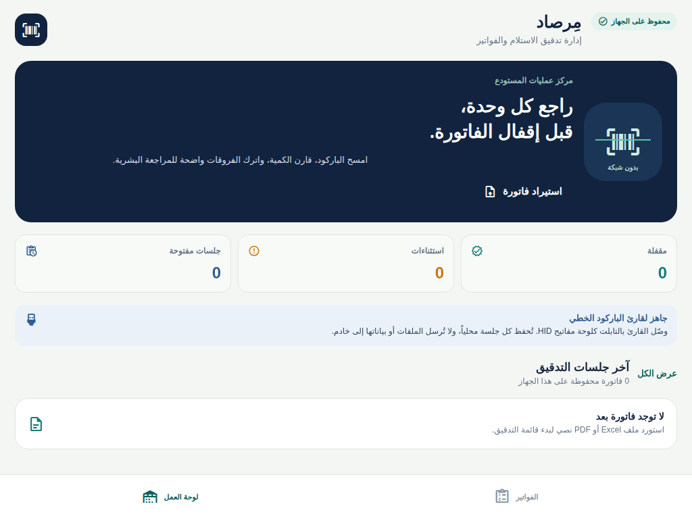
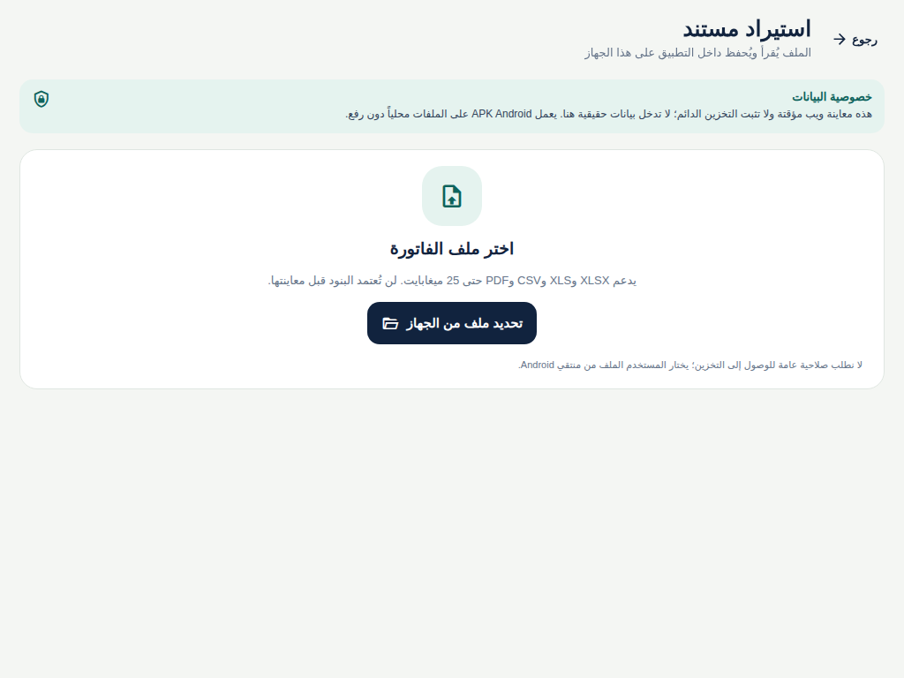
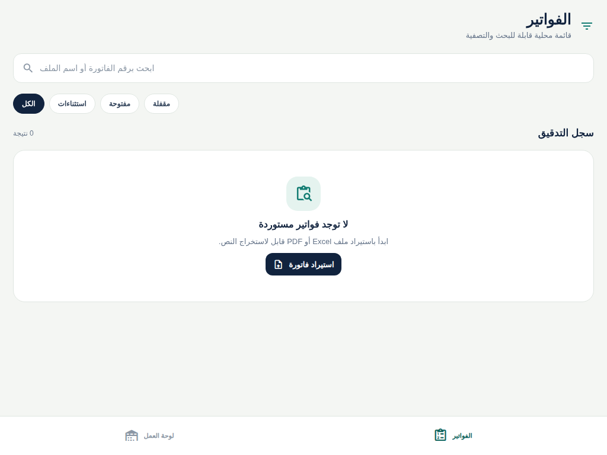
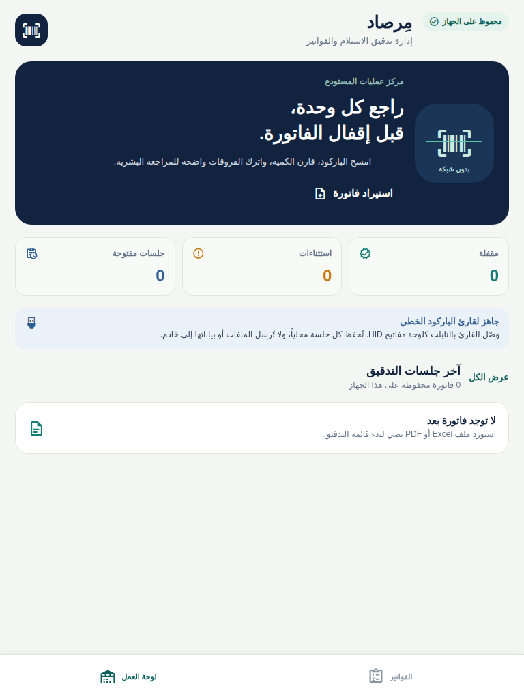

# تقرير تحقق أولي — مِرصاد المستودع

**التاريخ:** 4 نوفمبر 2026

**الملف المرجعي:** `wom.apk`

**النتيجة:** أُنجزت نسخة تطبيق جديدة داخل مشروع Expo Mobile. **لم يُبن APK بعد.**

## النطاق والتنفيذ

التطبيق مخصص لمشرف عمليات المستودع: استيراد ملفات Excel/XLSX وXLS وCSV وPDF محلياً، معاينة الحقول وربط أعمدة Excel، تجهيز جلسات قابلة للبحث والتصفية، ثم مسح الباركود ومقارنة الكمية المتوقعة بالممسوحة مع استثناءات يراجعها الإنسان. الواجهة عربية RTL ومتكيفة مع تابلت عمودي وأفقي. يحفظ Android الجلسة في SQLite والمصدر في مساحة التطبيق الخاصة؛ لا يستعمل التطبيق واجهات خلفية لمعاملات الفواتير ولا يرفع الملفات.

استخراج PDF يعمل مع المستندات التي تحتوي نصاً قابلاً للاستخراج: PDFBox/وحدة Expo أصلية على Android وPDF.js في معاينة Web. تُعرض المرشحات للمراجع كتخمينات تحتاج تأكيداً. **OCR لملفات PDF المصورة غير مشمول**؛ يرفضها التطبيق برسالة واضحة ولا يخترع صفوفاً.

## نتائج الفحص

| الفحص | النتيجة |
| --- | --- |
| TypeScript (`pnpm check`) | ناجح |
| ESLint (`pnpm lint`) | ناجح |
| Vitest | 37 ناجحاً، 1 متجاوزاً من قالب تسجيل الخروج |
| Expo Web export | ناجح؛ معاينة وليست تطبيق Android |
| Expo Android JavaScript bundle | ناجحة؛ ليست APK |
| المعاينة البصرية | لقطات للوحة والاستيراد والفواتير في 768×1024 و1024×768 |
| PDF | اختبار نص اصطناعي واختبار PDF تالف/بلا نص؛ لا بيانات عملاء ولا OCR |

اختُبرت قواعد مجال مثل تطبيع أرقام الباركود العربية/الفارسية مع الحفاظ على الأصفار الأولى، كل مسح كوحدة مستقلة حتى عند تكرار الرمز، فروق النقص والزيادة ومنع الإقفال مع استثناءات، الكمية العربية والفارسية والفواصل، ربط أعمدة Excel، وعدم إسقاط الصفوف غير الصالحة.

### إصلاحات المراجعة المستقلة

كشف تدقيق مستقل عن احتمال تداخل حفظ المسح مع حسم/تعديل/إقفال الجلسة بما قد يستبدل نسخة أحدث بأخرى قديمة، وعن عدم اتساق الأرقام الفارسية في تعديل الكمية. أُصلح ذلك بتسلسل جميع تغييرات الجلسة في طابور واحد، وتعطيل حقل HID أثناء نوافذ قرار المراجع، وإعادة استخدام محلل الكمية المحلية، وأُضيف اختبار لمسحين متتابعين للباركود نفسه. أعيد تشغيل `pnpm check` و`pnpm test` و`pnpm lint` بعدها ونجحت.

## ما لم يُعتمد بعد

1. لم يُنتج APK/AAB؛ بناء Android الأصلي يتم من Dashboard الرسمي بعد حفظ المصدر المقبول، ولا يُعد Expo export حزمة قابلة للتثبيت.
2. لم يُثبت التطبيق على تابلت Android فعلي؛ يلزم التحقق من منتقي SAF، قراءة URI، نسخة المصدر، وحدة PDF الأصلية واستعادة SQLite بعد إغلاق التطبيق وإعادة التشغيل.
3. يلزم اختبار قارئ USB/Bluetooth HID فعلياً مع إعدادات Enter وTab والقراءات المتتابعة. لا تثبت لقطات المتصفح عمل جهاز المسح.
4. لا يدعم الإصدار OCR لمستند PDF المصور؛ يجب توفير PDF نصي أو ملف Excel.

## الهوية والتثبيت

فحص `wom.apk` يبين أن Package ID هو `com.app.mywebapp`. الحزمة الجديدة `space.manus.marsood.t173502143869505` مستقلة للاختبار بجوار الأصل، وليست تحديثاً يثبّت فوقه. لم يرفق مصدر WOM أو مفتاح توقيعه الأصلي.

## لقطات الواجهات

